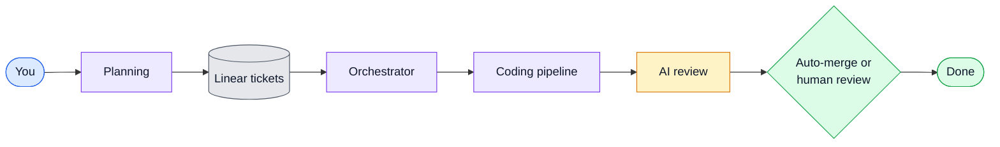
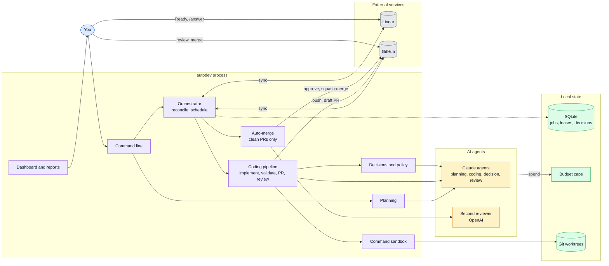

# autodev

A persistent orchestrator that turns your Linear tickets into reviewed, CI-green **draft PRs**
across several GitHub repos. It uses Claude Code agents in isolated git worktrees and runs
continuously on a small VM, including overnight.

You set direction and approve. autodev plans, implements, asks for decisions, reviews, and
reports. When enabled, autodev auto-merges clean PRs after CI, policy checks, and an independent
second review pass; otherwise, you review and merge.

```
idea ──▶ Planning Agent (reads the repo) ──▶ [Plan] + tickets in Backlog
                                   you approve ──▶ Ready
Ready ──▶ scheduler (priority, dependencies, conflicts, budget) ──▶ atomic claim + lease
      ──▶ worktree ──▶ Coding Agent ──(questions)──▶ Decision Agent ──▶ policy: auto | you
      ──▶ orchestrator-run validation ──▶ commit + secret scan ──▶ push ──▶ draft PR ──▶ CI
      ──▶ independent Review Agent ──(changes)──▶ bounded fix loop
      ──▶ In Review (+ preview URL) ──▶ auto-merge (if enabled and checks pass) or you merge
      ──▶ Done (verified on GitHub)
```

## Architecture

One Node process (systemd) owns job state. Linear and GitHub stay the source of truth for tickets and code.

### Overview



### Components

Solid arrows carry work; dashed arrows record state and spend.



| Box | Code |
|---|---|
| Command line | `src/cli.ts` |
| Dashboard and reports | `src/dashboard.ts`, `src/report.ts` |
| Orchestrator | `src/orchestrator.ts` (tick loop, reconcile) and `src/scheduler.ts` (priority, dependencies, conflicts) |
| Planning | `src/planning.ts`: idea → tickets |
| Coding pipeline | `src/pipeline.ts` |
| Decisions and policy | `src/decisions.ts`, `src/policy.ts` (policy can only escalate) |
| Auto-merge | `src/automerge.ts` (off unless `autoMerge: true`) |
| Command sandbox | `src/command-sandbox.ts`: bubblewrap or Seatbelt, offline |
| Claude agents | `src/agents/runner.ts` (Claude Agent SDK) |
| Second reviewer | `src/agents/second-review.ts` (OpenAI Responses API) |
| Linear | `src/tracker/linear.ts` (GraphQL) |
| GitHub | `src/scm/github.ts` (Octokit) |
| Git worktrees | `src/scm/git.ts` |
| SQLite | `src/db.ts`: jobs, leases, decisions, usage; every component reads and writes it |
| Budget caps | `src/budget.ts`: daily, monthly and per-ticket limits, recorded in SQLite |

`Tracker` (Linear | Local), `Scm` (GitHub | Local) and `AgentRunner` (Claude | Fake) are swappable seams, so
the whole flow runs in tests offline with no AI spend. Details: [docs/ARCHITECTURE.md](docs/ARCHITECTURE.md).

## Status

Phases 1–10 are implemented and tested:

- Automated unit, pipeline and audit regression tests on real git repositories.
- Audit fixes cover outgoing-history scanning, command isolation, budget reservations, mandatory diff policy, cancellation, conflicts and reconciliation.
- Historical live-Claude verification was reported separately; retained evidence is not included in this repo:
  - planning
  - ticket → PR
  - decision escalation
  - independent review
  - merge → Done

Connecting to **your** Linear, GitHub, and cloud VM needs your credentials and approval. See
[docs/SETUP.md](docs/SETUP.md).

## Commands

```bash
autodev plan "Add Stripe subscriptions with Free, Personal and Business plans" --project webapp --publish
autodev plan-approve <planId>        # or move the [Plan] issue to Ready in Linear
autodev run                          # the service (systemd)
autodev status | report | usage | decisions --pending
autodev answer ENG-42 "Use $12/month for Personal"   # or comment "/answer …" in Linear + move to Ready
autodev pause "reason" | resume
```

## Docs

- [Architecture](docs/ARCHITECTURE.md): components, lifecycle, leases and recovery, decision
  policy, costs, and build-vs-reuse findings
- [Security model](docs/SECURITY.md)
- [Setup](docs/SETUP.md): Claude auth choice, Linear, GitHub bot and branch protection, VM, previews, cost estimates
- [Runbook](docs/RUNBOOK.md): day-to-day operation, failure modes, local simulation

## Layout

```
src/
  cli.ts            commands
  orchestrator.ts   tick loop: recover leases → reconcile with Linear/GitHub → poll CI → schedule
  pipeline.ts       per-job stages, fix and review loops, blockers, PR body
  scheduler.ts      ranking + hard filters (dependencies, conflicts, capacity)
  planning.ts       idea → plan → tickets (dedupe, dependency graph, approval)
  decisions.ts      decision log, limits, Decision Agent, ADRs
  policy.ts         what may be decided without you (can only escalate)
  budget.ts         daily/monthly/ticket budgets, usage-limit and outage pauses
  db.ts             SQLite state: jobs/leases, decisions, plans, usage, events
  report.ts         morning summary (file + optional ntfy/Slack webhook)
  dashboard.ts      read-only mobile status page
  agents/           Claude Agent SDK runner, prompts, output schemas, fake runner
  tracker/          Linear (GraphQL) and local implementations
  scm/              GitHub (Octokit), local implementation, git worktrees
deploy/             systemd unit, cloud-init, Dockerfile
templates/github/   CI workflow for target repos
scripts/            branch protection helper
```

Requirements: Node ≥ 24, git, and a working OS sandbox (bubblewrap on Linux or Seatbelt on macOS). Setup and validation run offline with a private temporary HOME. Prepare dependencies in the worktree or a dedicated offline npm cache before running commands; see the setup guide.

The orchestrator keeps authoritative hashes and independent Git objects in protected `dataDir`; `workspaceDir` contains disposable agent checkouts and separate validation/review snapshots. Agent-visible refs are never used as policy or secret-scan boundaries. See the setup guide for the required folder layout and migration restrictions. Ubuntu VM and live-Claude verification of this latest change remain outstanding.
